<!-- Generated by GitHub Profile Agent Console. Edit profile.config.json, then run npm run generate. -->

  <picture>
    <source media="(max-width: 760px) and (prefers-color-scheme: dark)" srcset="./assets/hero/agent-console-3988c88c-mobile-dark.svg">
    <source media="(max-width: 760px)" srcset="./assets/hero/agent-console-3988c88c-mobile-light.svg">
    <source media="(prefers-color-scheme: dark)" srcset="./assets/hero/agent-console-3988c88c-dark.svg">
    <source media="(prefers-color-scheme: light)" srcset="./assets/hero/agent-console-3988c88c-light.svg">
    
  </picture>

  

## About Me

A student developer exploring the intersection of artificial intelligence, web development, and Linux customization.

I build practical digital experiences and experiment with ideas that connect technology, creativity, and intelligent systems.

## Current Focus

| Area | What I am exploring |
| --- | --- |
| **AI Applications** | Exploring practical applications that connect AI capabilities with useful digital experiences. |
| **Intelligent Search** | Experimenting with search systems that bring information from multiple sources into one workspace. |
| **Web Development** | Building modern web experiences with TypeScript, React, Next.js, and Tailwind CSS. |
| **Developer Productivity** | Exploring tools and workflows that support more effective software development. |
| **Linux Customization** | Personalizing Linux environments, including Arch Linux, around individual workflows. |
| **Cybersecurity** | Exploring cybersecurity alongside web development, AI, and Linux systems. |

## Featured Work

| Project | Focus | Why it matters |
| --- | --- | --- |
| **Bibliotheca** | Knowledge organization | A private knowledge library for organizing and accessing curated digital resources. |
| **Universal Search** | Intelligent search systems | Universal Search Workspace is an experimental concept for a system-wide search interface that brings information from multiple sources into one workspace. |
| **Mind Quest** | Educational games | An educational game concept focused on logic, reasoning, and problem-solving. |

## Research Direction

I explore how artificial intelligence, web development, developer tools, and Linux customization can connect into practical digital experiences and intelligent systems.

## Tech Stack

`TypeScript` · `JavaScript` · `React` · `Next.js` · `Tailwind CSS` · `Supabase` · `Git` · `Linux` · `Arch Linux`

## Recent Activity

<!-- AUTO:ACTIVITY:START -->
- Nov 13, 2026: pushed 1 commit to [lazy-arcanist/AVD_Praktikum_Adriel](https://github.com/lazy-arcanist/AVD_Praktikum_Adriel).
- Nov 13, 2026: created a branch in [lazy-arcanist/AVD_Praktikum_Adriel](https://github.com/lazy-arcanist/AVD_Praktikum_Adriel).
- Nov 4, 2026: pushed 1 commit to [lazy-arcanist/Digital-Curated-Library](https://github.com/lazy-arcanist/Digital-Curated-Library).
- Nov 5, 2026: pushed 1 commit to [lazy-arcanist/Digital-Curated-Library](https://github.com/lazy-arcanist/Digital-Curated-Library).
- Nov 4, 2026: created a branch in [lazy-arcanist/Digital-Curated-Library](https://github.com/lazy-arcanist/Digital-Curated-Library).
<!-- AUTO:ACTIVITY:END -->

---

  Exploring ideas and building practical digital experiences.

